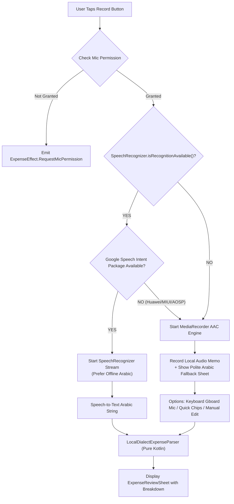

# 📐 Raqeem (رقيم) - Technical & Domain Specification (spec.md)

This specification defines the formal domain contracts, data models, MVI state machines, hardware fallback protocols, and Gherkin acceptance criteria for **Raqeem**.

---

## 🧱 1. Domain Data Contracts (Pure Kotlin `commonMain`)

All models are `@Serializable` to guarantee type-safe persistence with zero manual regex JSON parsing.

### 1.1 Category Model
```kotlin
@Serializable
enum class ExpenseCategory(
    val id: String,
    val arabicTitle: String,
    val iconRes: String,
    val colorHex: Long
) {
    GROCERIES("groceries", "بقالة وتموينات", "ic_groceries", 0xFF00C48C),
    DINING("dining", "مطاعم ومقاهي", "ic_dining", 0xFFFFA000),
    TRANSPORT("transport", "مواصلات وطاقة", "ic_transport", 0xFF22D3EE),
    BILLS("bills", "فواتير والتزامات", "ic_bills", 0xFFFF5C5C),
    HEALTH("health", "صحة وصيدلية", "ic_health", 0xFFAB47BC),
    GENERAL("general", "أخرى ومصروفات عامة", "ic_general", 0xFF94A3B8)
}
```

### 1.2 Payer & Split Model
```kotlin
@Serializable
data class Payer(
    val id: String,
    val name: String,
    val isCurrentUser: Boolean = true
)

@Serializable
data class ExpenseSplit(
    val totalAmount: Double,
    val payer: Payer,
    val participants: List<Payer>,
    val amountPerPerson: Double,
    val note: String = ""
)
```

### 1.3 Bank Proof Attachment Model
```kotlin
@Serializable
enum class ProofType {
    NONE,
    BANK_SMS,
    RECEIPT_PHOTO,
    AUDIO_MEMO
}

@Serializable
data class BankSmsProof(
    val bankName: String,
    val rawText: String,
    val extractedAmount: Double,
    val currency: String,
    val merchant: String,
    val transactionTimestamp: Long
)
```

### 1.4 Core Expense Models
```kotlin
@Serializable
data class ExpenseItem(
    val id: String,
    val title: String,
    val amount: Double,
    val currency: String = "₪",
    val category: ExpenseCategory,
    val timestamp: Long, // Epoch millis via kotlinx-datetime
    val payer: Payer = Payer("self", "أنا", true),
    val split: ExpenseSplit? = null,
    val proofType: ProofType = ProofType.NONE,
    val proofDetails: BankSmsProof? = null,
    val rawSpokenText: String = ""
)

@Serializable
data class ExpenseBatch(
    val batchId: String,
    val items: List<ExpenseItem>,
    val totalBatchAmount: Double,
    val createdAt: Long
)
```

---

## 🔄 2. MVI Unidirectional Data Flow Architecture

```text
       ┌───────────────┐
       │     User      │
       └───────┬───────┘
               │ Emits
               ▼
       ┌───────────────┐
       │ ExpenseIntent │
       └───────┬───────┘
               │ Handled by
               ▼
     ┌───────────────────┐
     │ ExpenseViewModel  │◄────► ExpenseRepository
     └─────────┬─────────┘       (Offline Storage)
               │ Updates
               ├──────────────────────┐
               ▼                      ▼
     ┌───────────────────┐  ┌───────────────────┐
     │  ExpenseUiState   │  │   ExpenseEffect   │ (SharedFlow)
     └─────────┬─────────┘  └─────────┬─────────┘
               │ Collected by         │ Observed for
               ▼                      ▼
       ┌───────────────┐     ┌───────────────────┐
       │ Compose Screen│     │ Haptic/Toast/Nav  │
       └───────────────┘     └───────────────────┘
```

### 2.1 UI State Contract
```kotlin
data class ExpenseUiState(
    val isLoading: Boolean = false,
    val isRecording: Boolean = false,
    val recordingAmplitude: Float = 0f, // 0.0 to 1.0 for dynamic waveform ring
    val todayTotal: Double = 0.0,
    val weeklyTotal: Double = 0.0,
    val activeCurrency: String = "₪",
    val recentExpenses: List<ExpenseItem> = emptyList(),
    val reviewSheetPendingBatch: ExpenseBatch? = null,
    val isHardwareSpeechAvailable: Boolean = true,
    val showFallbackManualSheet: Boolean = false,
    val userErrorMessage: String? = null
)
```

### 2.2 Intent Contract
```kotlin
sealed interface ExpenseIntent {
    data object CheckPermissionsAndStartRecord : ExpenseIntent
    data object StopRecording : ExpenseIntent
    data class ParseManualSpeechText(val rawText: String) : ExpenseIntent
    data class ParseBankSms(val smsBody: String) : ExpenseIntent
    data class ConfirmBatch(val batch: ExpenseBatch) : ExpenseIntent
    data class DeleteExpense(val expenseId: String) : ExpenseIntent
    data class FilterByCategory(val category: ExpenseCategory?) : ExpenseIntent
    data object DismissReviewSheet : ExpenseIntent
    data object DismissFallbackSheet : ExpenseIntent
    data object CompleteOnboarding : ExpenseIntent
}
```

### 2.3 Effect Contract (Single-Shot Events)
```kotlin
sealed interface ExpenseEffect {
    data class ShowToast(val message: String) : ExpenseEffect
    data object TriggerHapticFeedback : ExpenseEffect
    data object RequestMicPermission : ExpenseEffect
    data class NavigateToDetails(val expenseId: String) : ExpenseEffect
}
```

---

## 🛡️ 3. Hardware Contention Defense & Dual-Branch Protocol



---

## 💾 4. Persistence & App Preferences Contract

```kotlin
// commonMain
expect class AppPreferences {
    fun isOnboardingCompleted(): Boolean
    fun setOnboardingCompleted(completed: Boolean)
    fun getPreferredCurrency(): String
    fun setPreferredCurrency(currency: String)
}

expect class PlatformExpenseStorage {
    suspend fun saveExpense(item: ExpenseItem)
    suspend fun getAllExpenses(): List<ExpenseItem>
    suspend fun deleteExpense(id: String)
}
```

- **Android Implementation:**
  - `AppPreferences`: Backed by Android `SharedPreferences` in private mode.
  - `PlatformExpenseStorage`: Atomic encrypted JSON file or Room KMP database.
- **iOS Implementation:**
  - `AppPreferences`: Backed by `NSUserDefaults.standardUserDefaults`.
- **Desktop/JVM Implementation:**
  - `AppPreferences`: Local file in `$HOME/.raqeem/config.json`.

---

## 🧪 5. Acceptance Test Criteria (Gherkin Scenarios)

### Scenario 1: Natural Voice Logging of Commuter Expense
```gherkin
Feature: Voice Expense Logging
  Scenario: Commuter records fuel expense with Arabic number word and currency
    Given the app is launched and mic permission is granted
    When the user taps the mic and says "دفعت خمسين شيكل بنزين"
    Then the LocalDialectExpenseParser should extract:
      | Field    | Expected Value          |
      | Amount   | 50.0                    |
      | Currency | "₪"                     |
      | Category | TRANSPORT (مواصلات وطاقة) |
      | Payer    | "أنا" (Current User)     |
    And the ExpenseReviewSheet should appear within 3 seconds
```

### Scenario 2: Shared Dinner with Multi-Payer Split
```gherkin
Feature: Multi-Payer Shared Expense
  Scenario: Flatmates split dinner bill paid by someone else
    Given the user is on the dashboard
    When the user speaks "عشاء بستين شيكل بيني وبين أحمد على حساب أحمد"
    Then the parser should calculate:
      | Field             | Value                |
      | Total Amount      | 60.0                 |
      | Category          | DINING (مطاعم ومقاهي) |
      | Payer             | "أحمد"               |
      | Participants      | ["أنا", "أحمد"]       |
      | Per Person Amount | 30.0                 |
```

### Scenario 3: Offline Hardware Fallback on Unsupported Android Device
```gherkin
Feature: Speech Hardware Fallback
  Scenario: Device lacks Google Speech Services (MIUI/HyperOS/Huawei)
    Given SpeechRecognizer.isRecognitionAvailable() returns false
    When the user taps the record button
    Then the app must NOT crash with ERROR_AUDIO
    And local MediaRecorder must capture the AAC audio memo
    And the Polite Fallback Sheet must display with Gboard keyboard input option
```

### Scenario 4: Cold Start Onboarding Persistence
```gherkin
Feature: Onboarding Lifecycle
  Scenario: User completes onboarding and restarts app
    Given the user finishes the onboarding tutorial and taps "ابدأ الآن"
    When the app process is terminated and relaunched
    Then the app must launch directly to the Dashboard
    And the onboarding screen must never be rendered again
```

